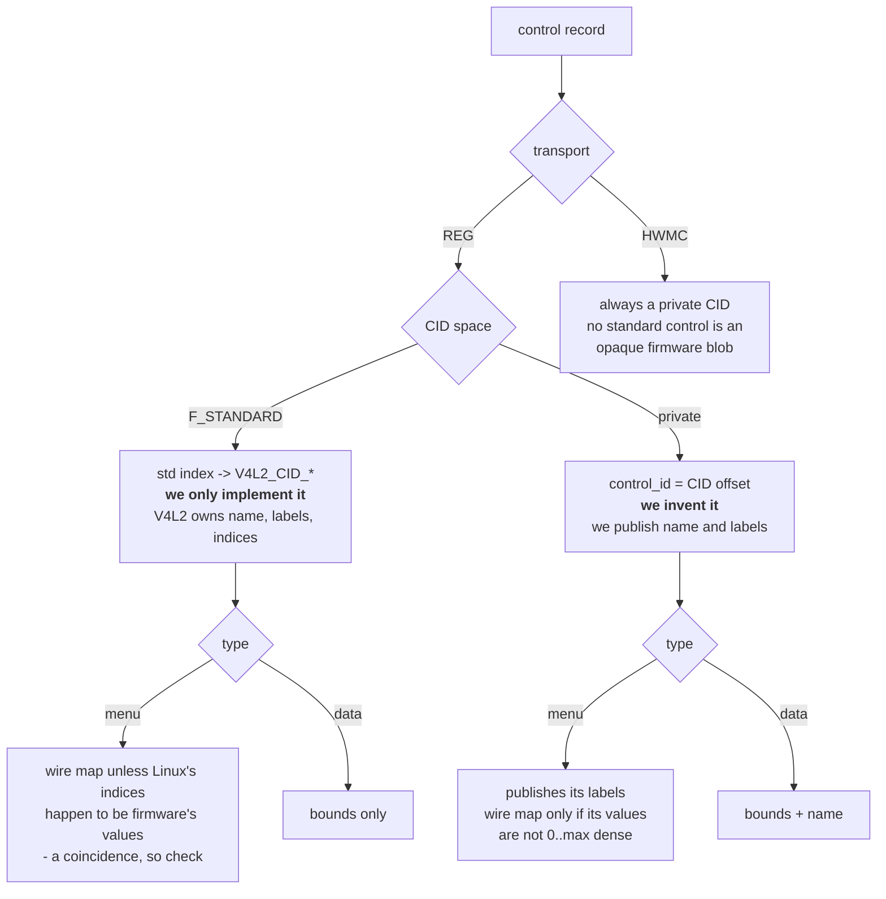
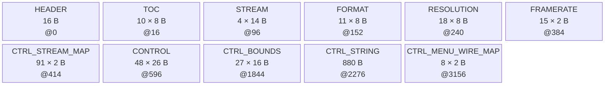

<!-- Source of truth for this design note. Edit it here.

     Companion to camera-format-descriptor.md: same blob, same aperture, more tables.
     Part 1 is normative. Parts 2-4 are examples, reasoning and evidence; nothing in
     them changes the specification. -->

# Camera-Resident Control Descriptor

The format descriptor moved *what a camera can stream* onto the camera. This moves *what a
camera can be told*: the V4L2 control set becomes descriptor data, and the driver builds its
registration and its register access from that instead of from per-SKU tables in its source.

DESIGN NOTE **control descriptor** · STATUS **design — for review** · DRIVER **kernel/realsense/d4xx_main.c** · TICKET **RSDEV-14835** · COMPANION **[camera-format-descriptor.md](camera-format-descriptor.md)**

> **Part 1 is the specification** — what is built, with no argument for it. **Part 2** shows
> what real controls look like on the wire. **Part 3** is the reasoning and the decisions
> taken against. **Part 4** is the inventory it was all derived from.

> Sources: `kernel/realsense/d4xx_main.c` at `dev` (`e413d0a`) plus PR #700 (RSDEV-15386,
> approved), and a live enumeration on **fw-orin-5** — D585 at `9-001a`, D457 at `9-002a`,
> JP6.2, module 1.0.7.9. Every per-SKU difference claimed in Part 4 was read off those two
> cameras. Designed against four subdev instances per camera; the single-instance redesign is
> postponed and is not an input.

---

# Part 1 · The design

## 1.1 In one page

The camera publishes its control set as tables in the RSDS blob at `RS_DESC_BASE`, beside the
format tables. The driver registers V4L2 controls by walking them and executes them through
two generic transports.

- **Five new tables**, optional as a group; the format tables stay mandatory.
- **Two transports.** `REG` — a packed struct at an address, a single register being the
  one-field case. `HWMC` — a mailbox command.
- **Every per-control fact is on the wire**, names and menu strings included. The driver
  holds no table keyed by control.
- **Four driver-side registries**, all bounded by Linux or by the transport, none growing
  when firmware adds a control.
- **Firmware owns every state-dependent refusal** (§3.7). The driver does not track which
  controls are legal while streaming; it writes, verifies where told to, and reports.
- **Five controls keep driver code**, as hooks. Every one of them reaches outside the camera
  or is pinned by a librealsense payload convention.
- A new private `REG` control of a known type costs **no driver change**.


## 1.2 Transports

A transport is how the control's bytes reach the camera. There are two, and the record says
which in `transport`.

### REG — a packed struct at an address

The driver transfers `extent` bytes to or from `addr`. A scalar is the one-field case; a
D5xx XU window is the general one.

`addr` is absolute unless the record sets `F_ADDR_RELATIVE`, in which case it is an offset
into the **advertising stream's `ctrl_base`**, which that stream's record publishes. The
driver holds no notion of where a stream's control block lives — today it derives
`control_base` from the DT `cam-type` string and a pair of `#define`s, and that mapping goes
away. Relative addressing exists because firmware's own model is a block per camera with an
identical layout (`REG_BASE_CAM0_CONTROLS`, `REG_BASE_CAM1_CONTROLS`, stride `0x100`), so
one record can serve two streams whose bases differ.

| `extent` | Means | Today |
|---|---|---|
| 1, 2 or 4 | a scalar of that width | 1 B for a D58x XU byte, 2 B for a D4xx control register, 4 B for exposure's register pair |
| anything else | a byte window, and `elems` must equal it | 38 B — `sizeof(struct d500_dpp_xu_control)` |

**1–38 B is what cameras publish today, not the limit.** The ceiling is
`RS_CTRL_MAX_EXTENT`, **256 bytes**, the chunk size the descriptor fetch already proves good
for a single `regmap` transfer. A record above it is refused outright (§1.8), so a future
40-byte window works and a 400-byte one is declined with a log line — never truncated, and
never clocked onto the bus to find out.

### HWMC — a mailbox command

The driver builds a `hwm_cmd` from `opcode_set`/`opcode_get`, places the value in a parameter
or in `Data`, sends it, and waits on the status register. Request is a 20-byte header plus
payload; the response is bounded by `DS5_HWMC_BUFFER_SIZE`, 1 KB.

A record is refused only when its opcode is one whose host sequence the driver owns and no
hook is bound for it (§1.8). An opcode the driver has never seen is registered and works.

### Two axes, not one

Transport is independent of **whose CID it is**, and both matter to what a record must carry:



**Standard** controls are ones V4L2 already defines — `V4L2_CID_EXPOSURE_ABSOLUTE`,
`V4L2_CID_SATURATION`. A camera cannot mint one, so it names it by index into the driver's
standard-CID map (§1.12) and inherits Linux's name, labels and index numbering; the camera
supplies only bounds, flags and mechanism. Thirteen of the forty-nine controls are of this
kind.

**Private** controls are ours: we assign the `control_id`, publish the name, and for a menu
publish the labels and choose the values. Today every private menu numbers its indices to
match its firmware values, so it needs no wire map — a convenience, not a rule (§1.6).

The one combination that does not occur is a standard HWMC control, because no V4L2-defined
control is an opaque firmware blob.

## 1.3 Blob changes

```c
enum rs_desc_table {
	RS_DESC_T_STREAM = 1,
	RS_DESC_T_FORMAT,
	RS_DESC_T_RESOLUTION,
	RS_DESC_T_FRAMERATE,
	RS_DESC_T_LAST_REQUIRED = RS_DESC_T_FRAMERATE,

	/* Optional as a group, and numbered in reference order: a stream names
	 * controls, a control names its bounds, labels and wire values.
	 */
	RS_DESC_T_CTRL_STREAM_MAP,    /* flat u16 pool: control indices,
				       * one slice per stream                  */
	RS_DESC_T_CONTROL,            /* the records themselves                */
	RS_DESC_T_CTRL_BOUNDS,        /* min/max/step/def                      */
	RS_DESC_T_CTRL_STRING,        /* flat NUL-separated u8 pool:
				       * control names and menu labels         */
	RS_DESC_T_CTRL_MENU_WIRE_MAP, /* flat u16 pool: menu index -> wire
				       * value, for any menu whose two
				       * numberings differ. Omitted when no
				       * menu needs one                        */
	RS_DESC_T_MAX = RS_DESC_T_CTRL_MENU_WIRE_MAP,
};
```

- `ver_minor` bump, not `ver_major`. `ds5_desc_find_tables()` already skips table types it
  predates.
- **`ds5_desc_find_tables()`'s present-check loop must be re-bounded** from `RS_DESC_T_MAX`
  to `RS_DESC_T_LAST_REQUIRED`, in the same change as the enum. Without that, a new driver
  rejects every existing blob — formats included.
- The control set is present or absent as a whole; absent ⇒ built-in tables. **Within it, a
  pooled table with no entries is omitted rather than served empty** — `ds5_desc_find_tables()`
  rejects a TOC entry with `n_entries == 0`. `CTRL_MENU_WIRE_MAP` is the one commonly absent:
  a camera is free of it unless some menu's indices and firmware values differ, which on
  today's SKUs means its standard menus and nothing else. `CTRL_BOUNDS` and `CTRL_STRING` are
  absent only in theory.
- `RS_DESC_MAX_SIZE` rises **2048 → 8192**.

## 1.4 The blob, laid out

Before the records themselves, the shape they sit in. Sizes are a D585's — 48 controls
across 91 (stream, control) pairs — as a concrete instance, not a requirement.



**Figure 1.** Regions in blob order with record count, stride and byte offset; boxes are
equal width rather than to scale. The order is **reference order** — a stream names controls,
a control names its bounds, labels and wire values — matching the enum in §1.3. The TOC is
what the driver actually reads, so a generator may lay them out in any order; this one is
simply the order they are consumed in.

| Region | Entries | Stride | Bytes | At |
|---|---|---|---|---|
| Header | — | — | 16 | 0 |
| TOC | 10 | 8 | 80 | 16 |
| Stream | 4 | 14 | 56 | 96 |
| Format | 11 | 8 | 88 | 152 |
| Resolution | 18 | 8 | 144 | 240 |
| Framerate | 15 | 2 | 30 | 384 |
| **Stream map** | 91 | 2 | **182** | 414 |
| **Control** | 48 | 26 | **1248** | 596 |
| **Bounds** | 27 | 16 | **432** | 1844 |
| **Strings** | — | — | **~880** | 2276 |
| **Menu wire values** | 8 | 2 | **16** | 3156 |
| **Total** | | | **~3172** | |

Two things the figure makes visible. **`CONTROL` is 40% of the blob and `CTRL_STRING`
another 28%** — between them they are most of the growth over the format-only descriptor,
and both scale with the control count rather than with the number of SKUs. And **every
reference is an index or offset carried in the TOC**, so a driver finds each table by type
rather than by position, and an older or newer blob with a different layout parses the same.

**Part 2** works one of these blobs through record by record.

## 1.5 Records

```c
struct rs_desc_control {                  /* 26 B */
	u16 control_id;           /* private CID offset, or standard-map index if F_STANDARD */
	u8  v4l2_type;            /* enum rs_ctrl_type */
	u8  transport;            /* RS_CTRL_XPORT_* */
	u16 flags;                /* RS_CTRL_F_* */
	u16 elems;                /* array length; 1 = scalar */
	u16 menu_mask;            /* bit i set = menu index i absent; 0 = all present.
				   * Indexed by menu index, so a menu has at most 16
				   * entries. Publish the minimal form: bits above
				   * `max` are never consulted - see §1.6 */
	u16 bounds;               /* index into CTRL_BOUNDS, 0xFFFF = none */
	u16 name_offset;          /* into CTRL_STRING; 0 only if F_STANDARD */
	u16 menu_offset;          /* into CTRL_STRING, max+1 labels; 0 if not a private menu */
	u16 menu_wire_map_offset; /* into CTRL_MENU_WIRE_MAP, max+1 values.
				   * 0 = the index IS the wire value */
	union {                   /* discriminated by `transport`, never variable-length */
		struct rs_desc_mech_reg  reg;
		struct rs_desc_mech_hwmc hwmc;
	} mech;
} __packed;

struct rs_desc_mech_reg {             /* 8 B */
	u16 addr;           /* absolute, or an offset into the stream's
			     * ctrl_base if F_ADDR_RELATIVE */
	u16 extent;         /* bytes transferred; for a scalar, its width.
			     * 1..RS_CTRL_MAX_EXTENT (256) - see §1.2 */
	u32 rsvd;           /* holds the union at 8 B; do not shrink the struct to
			     * reclaim it - both arms must stay the same size */
} __packed;

struct rs_desc_mech_hwmc {            /* 8 B */
	u8  opcode_set;     /* 0xFF = not settable */
	u8  opcode_get;     /* 0xFF = not gettable */
	u8  value_param;    /* 0 = value rides in Data; else first param index,
			     * consuming `elems` of them */
	u8  const_param;    /* param index carrying const_value, 0 = none */
	u16 const_value;
	u16 resp_bytes;     /* expected response payload; 0 = take it from
			     * DS5_HWMC_RESP_LEN at read time */
} __packed;

struct rs_desc_ctrl_bounds { s32 min, max, step, def; } __packed;      /* 16 B */

struct rs_desc_stream {               /* 6 B -> 14 B */
	u16 stream_id;
	u16 fmt_first;
	u16 fmt_count;
	u16 ctrl_first;     /* NEW: into CTRL_STREAM_MAP */
	u16 ctrl_count;     /* NEW: 0 = this stream advertises none */
	u16 ctrl_base;      /* NEW: base of this stream's control block; an
			     * F_ADDR_RELATIVE address is an offset into it */
	u16 status_addr;    /* NEW: the result register for this stream's REG
			     * controls; 0 = none, and every control on the
			     * stream must then set F_NO_STATUS */
} __packed;
```

Growing the stream record is safe in both directions: `ds5_desc_rec()` zeroes the destination
then copies `min(sizeof, stride)`, so a new driver reading an old 6-byte record sees
`ctrl_count = 0`.

## 1.6 Enumerations and flags

```c
enum rs_ctrl_type {                   /* -> V4L2_CTRL_TYPE_*, via the type map */
	RS_CTRL_T_INTEGER = 1, RS_CTRL_T_BOOLEAN, RS_CTRL_T_MENU,
	RS_CTRL_T_BUTTON,      RS_CTRL_T_U8_ARRAY, RS_CTRL_T_U32_ARRAY,
};

#define RS_CTRL_F_READ_ONLY      BIT(0)
#define RS_CTRL_F_VOLATILE       BIT(1)  /* read: call the driver, never the core's copy  */
#define RS_CTRL_F_EXEC_ON_WRITE  BIT(2)  /* write: call the driver even if unchanged      */
#define RS_CTRL_F_READ_TO_CLEAR  BIT(3)  /* a read consumes the value */
#define RS_CTRL_F_ADDR_RELATIVE  BIT(4)  /* REG: addr is an offset into the
					  * advertising stream's ctrl_base */
#define RS_CTRL_F_CAMERA_SCOPE   BIT(5)  /* applies to the camera, not one sensor */
#define RS_CTRL_F_STANDARD       BIT(6)  /* control_id indexes the standard-CID map */
#define RS_CTRL_F_RESP_SKIP_HDR  BIT(7)  /* HWMC: drop the 4-byte header from the response */
#define RS_CTRL_F_NO_STATUS      BIT(8)  /* firmware reports NO result for this write;
					  * skip the status read. Rare - see §3.9.2 */
#define RS_CTRL_F_LSW_LATCH      BIT(9)  /* REG: a scalar spanning 16-bit registers that
					  * firmware acts on at the low half-word */
```

A flag may describe only the **camera's own behaviour**. Host-side consequences are never
flagged; they are hooks.

**A menu's index space is never the individual camera's to choose**, and that is what makes
`menu_mask` necessary rather than merely convenient.

For a **standard** menu the index space is Linux's — `V4L2_CID_EXPOSURE_AUTO` is numbered by
`enum v4l2_exposure_auto_type`, and a camera implementing two of its four modes masks the
other two.

For a **private** menu it is the *family's*, not the camera's. librealsense maps its own
option values to V4L2 menu indices at compile time, so index 2 of `camera_sync_mode` must
mean *External Sync* on a D457 and on a D585 alike. A D58x with no Master role therefore
publishes three entries and masks index 1; publishing two would shift External down to 1 and
collide with D457's Master. So **a private menu's indices are an append-only shared registry,
exactly like `control_id`** — a camera chooses which entries it *has*, never what they are
numbered.

The labels come from the camera either way, and this is the difference the two cases make
visible: a standard menu publishes no labels, because the V4L2 core names
`v4l2_exposure_auto_type` itself, while a private menu publishes `max + 1` of them at
`menu_offset`. That is how anything knows index 1 of `camera_sync_mode` is *Master* —
`control[7]` in §2.1 points at `"Default" "Master" "External Sync"` in the string pool.

**Whether the index is the wire value is a per-menu fact, not a per-kind one.** Either kind
may be identity, and `menu_wire_map_offset = 0` says so:

| | Identity today | Needs a map |
|---|---|---|
| **Private** | `visual_preset` `0..5`, `camera_sync_mode` `0..2` — the camera numbered its indices to match its own values | a menu whose firmware values are sparse, say `1` and `500` |
| **Standard** | `V4L2_CID_POWER_LINE_FREQUENCY` — V4L2's `0..3` happen to be the firmware's, and the driver writes `ctrl->val` straight through | `V4L2_CID_EXPOSURE_AUTO` — index `1` is value `0` on depth and `1` on RGB |

The sparse private case is not hypothetical merely because none exists: the mask is indexed
by **menu index**, so a value of 500 would need a 501-entry menu, and `menu_mask` is a `u16`
— **sixteen entries is the ceiling**. Such a menu must publish indices `0`,`1` and a wire map
of `{ 1, 500 }`.

The asymmetry is in how the two kinds *establish* identity rather than whether they may have
it. A private menu knows by construction, because the camera chose both numberings. A
standard menu's identity is a **coincidence between two independent numberings**, confirmable
only by reading the Linux enum — so a generator must check it per control rather than assume
it, and the cross-check tool should verify that a zero offset really does match what the
driver writes.

**Masked entries still get a label.** The V4L2 `qmenu` array is indexed by menu index, so the
slot has to exist; the core never returns the string, so its content is free. Publishing the
real name anyway keeps the blob auditable — a cross-check tool can assert that every camera
in the family agrees on index → label, which is the only mechanical defence against a
renumber.

`menu_wire_map_offset` does not subsume it either. That maps index → *wire value* for a standard
menu; the mask says which indices exist at all. A camera needs both whenever its wire values
and the V4L2 indices diverge *and* some entries are absent.

`F_STANDARD` affects identity and naming only: `name_offset` and `menu_offset` are 0 and the V4L2
core supplies the name and labels. `bounds`, `menu_mask`, `menu_wire_map_offset`, `flags` and `mech`
still come from the record.

**Reading the result is the default**, because firmware produces one for all but a handful
of REG controls (§3.9.2). `F_NO_STATUS` marks those exceptions. The driver never learns *why*
a write was refused beyond what the result says, and holds no notion of which controls are
legal in which state — that is firmware's (§3.7).

## 1.7 Building a `v4l2_ctrl_config`

| Wire | Becomes |
|---|---|
| `control_id`, no `F_STANDARD` | `.id = DS5_CAMERA_CID_BASE + control_id` |
| `control_id`, `F_STANDARD` | `.id =` standard-CID map lookup |
| `v4l2_type` | `.type` via the type map; `.elem_size` follows |
| `elems` | `.dims[0]`; `elems == 1` ⇒ scalar, no `dims` |
| `bounds` → `CTRL_BOUNDS` | `.min` `.max` `.step` `.def` |
| `menu_mask` | `.menu_skip_mask` |
| `name_offset` → `CTRL_STRING` | `.name` |
| `menu_offset` → `CTRL_STRING` | `.qmenu` |
| `flags` bits 0–2 | `.flags` |
| `menu_wire_map_offset`, `mech` | not `v4l2_ctrl_config` fields — they drive §1.9 |

## 1.8 Parser rules

**Refuse the record** (register nothing for it, log once) when:

1. `transport == HWMC` and the opcode is on the wrapper-required list (§1.11) while no hook
   is bound for that `control_id`. An opcode the driver has never seen is **not** a reason to
   refuse.
2. `[addr, addr + extent)` overlaps another control's window on the same node.
3. The resulting CID duplicates one already registered on that node.
4. `control_id` would put the CID outside the camera control class.
5. A string or value offset lands outside its pool; a name is unterminated, over 32 bytes,
   or non-printable; a non-zero `menu_offset` has fewer than `max + 1` **labels** after it;
   a non-zero `menu_wire_map_offset` has fewer than `max + 1` **values** after it. Labels are
   strings in `CTRL_STRING`, values are `u16`s in `CTRL_MENU_WIRE_MAP` — a menu may carry
   either, both or neither.
6. `v4l2_type`, or with `F_STANDARD` the `control_id`, is not in the driver's maps.
7. `extent` is 0, exceeds `RS_CTRL_MAX_EXTENT` (256), or disagrees with `elems`: a scalar
   (`elems == 1`) must be 1, 2 or 4 bytes, and an array must have `extent == elems`. A
   mismatch would otherwise read or write past the V4L2 payload.

**Always:**

- Save and restore `hdl->error` around each record. `v4l2_ctrl_new()` sets it on rejection
  and every later `v4l2_ctrl_new*()` early-returns while it is set, so one bad record would
  otherwise drop every control after it on that node.
- `CTRL_STRING` ends in `NUL`.
- Published strings live in the **parsed, module-lifetime** tables, never the temporary fetch
  buffer: `ctrl->name` stores the pointer, not a copy.

## 1.9 Driver structure

**Registration** replaces `ds5_ctrl_init()`'s `sid` branching and all three per-SKU fixup
passes:

```c
for (i = 0; i < stream->ctrl_count; i++) {
	const struct rs_desc_control *c = &desc->controls[map[stream->ctrl_first + i]];
	struct v4l2_ctrl_config cfg;
	int saved = hdl->error;

	if (!ds5_ctrl_record_ok(state, c))      /* §1.8 */
		continue;
	ds5_ctrl_cfg_from_desc(state, c, &cfg); /* §1.7 */
	v4l2_ctrl_new_custom(hdl, &cfg, sensor);
	if (hdl->error && !saved)
		hdl->error = 0;
}
```

**Dispatch** — `ds5_s_ctrl()` and `ds5_g_volatile_ctrl()` share one body:

```c
h = ds5_ctrl_hooks(ctrl->id);              /* NULL for all but five */
if (h && h->pre) { ret = h->pre(...); if (ret) return ret; }

ret = (h && h->exec) ? h->exec(state, c, ctrl, set)
    : (c->transport == RS_CTRL_XPORT_REG) ? ds5_ctrl_xfer_reg(state, c, ctrl, set)
					  : ds5_ctrl_xfer_hwmc(state, c, ctrl, set);

if (!ret && h && h->post) ret = h->post(...);
```

**`ds5_ctrl_xfer_reg()`** resolves the address — `F_ADDR_RELATIVE` ⇒
`stream->ctrl_base + addr`, otherwise `addr` as given — and transfers `extent` bytes.
An `F_LSW_LATCH` scalar is **not** one transfer:
it is one 2-byte write per 16-bit register, **high half-word first**, because firmware acts
on the write to the low one (§3.8). Reads of the same control may burst.

Unless the record sets `F_NO_STATUS`, it then reads the result:

```c
mutex_lock(&state->ds5_dev->lock);
ret = <write the control>;
if (!ret)
	ret = ds5_ctrl_await_status(state, stream->status_addr);
mutex_unlock(&state->ds5_dev->lock);
```

`ds5_ctrl_await_status()` polls `status_addr` with `ds5_read_poll()` until it leaves
`RS_CTRL_STATUS_WIP`, bounded like the HWMC wait, and maps the result to an errno (§1.10).

**The lock is `ds5_dev->lock`, camera-wide, and it must span the write and the poll.** The
result register is per *control block*, not per node: depth, IR and IMU all write controls at
`0x4100` and all report into the same `0x401E`. A sibling's write between ours and our read
would hand us its result. Firmware's own sent/completed sequence counters leave the register
`WIP` while more than one write is outstanding, which is the same hazard seen from the other
side.

**`ds5_ctrl_xfer_hwmc()`** builds the `hwm_cmd` from the opcode pair, scatters `elems` values
from `value_param` or places the payload in `Data`, plants `const_value` at `const_param`,
sends and waits. With `resp_bytes == 0` it reads `DS5_HWMC_RESP_LEN`, rejects a length over
the control's payload with `-ENOBUFS`, reads `DS5_HWMC_DATA`, and drops the leading 4 bytes
if `F_RESP_SKIP_HDR`.

**Both** return `-EBUSY` while `cached_device_type` is `DS5_DEVICE_TYPE_UNKNOWN`.

**Menu translation** — with a non-zero `menu_wire_map_offset`, the run there is
`bounds.max + 1` entries long and entry *i* is the value to write for V4L2 menu index *i*. A
write sends `CTRL_MENU_WIRE_MAP[menu_wire_map_offset + index]`; a read searches the run for
the value the camera returned and reports its index. Entries at masked indices are never
read and may be anything. With a zero offset the index **is** the wire value and both
directions are the identity — true for every private menu shipping today, and for the
standard `V4L2_CID_POWER_LINE_FREQUENCY` as well.

## 1.10 Control result status

`status_addr` holds a result for the last REG control write on that block. The values are
firmware's existing `I2C_STATUS_*`:

| Wire | Meaning | Driver returns |
|---|---|---|
| `RS_CTRL_STATUS_OK` (0) | the control was applied | `0` |
| `RS_CTRL_STATUS_ERROR` (1) | firmware rejected or failed it | `-EIO` |
| `RS_CTRL_STATUS_WIP` (2) | still in flight | poll; `-ETIMEDOUT` past the bound |

When firmware also publishes the request error code (§1.13), the driver maps that instead:

| `ETControlReturnCode` | Driver returns |
|---|---|
| `CRC_SUCCESS` | `0` |
| `CRC_NOT_READY_ERR`, `CRC_WRONG_STATE_ERR` | `-EBUSY` |
| `CRC_OUT_OF_RANGE_ERR` | `-ERANGE` |
| `CRC_INVALID_UNIT_ERR`, `CRC_INVALID_CONTROL_ERR` | `-EOPNOTSUPP` |
| `CRC_INVALID_REQUEST_ERR` | `-EINVAL` |
| `CRC_POWER_ERR` | `-EIO` |

The status is **asynchronous**: a write is dispatched and completes later, so the driver
polls rather than reading once.

> [!NOTE]
> **The reason already exists in firmware and is thrown away.** `UvcControlMsg()` computes a
> full `ETControlReturnCode` — the UVC Request Error Code Control, verbatim from the spec —
> and hands it to the completion callback, where `I2cHostIfUvcControlHandleComplete()`
> discards it with `(void)value;` and keeps only OK/ERROR. §1.13 asks firmware to publish it,
> not to invent it. Until it does, `-EIO` is the honest answer and the driver must not guess
> a more specific one.

## 1.11 The hooks that remain

```c
struct ds5_ctrl_ops_desc {
	u16  control_id;
	int (*pre)(struct ds5 *, const struct rs_desc_control *, struct v4l2_ctrl *);
	int (*exec)(struct ds5 *, const struct rs_desc_control *, struct v4l2_ctrl *, bool set);
	int (*post)(struct ds5 *, const struct rs_desc_control *, struct v4l2_ctrl *);
};
```

| Control | Hook | What it does | Why it cannot move |
|---|---|---|---|
| `hw_reset` | `exec` | cooldown · `dser_ops->recover_link` · stop four FW streams · bump reset generation · clear `cached_device_type` and the streaming flags · scratch readiness · send `0x20` · poll · re-alias I2C · `ds5_hw_init()` · per-link line-buffer flush · `ds5_desc_reload_after_reset()` | reaches the deserializer, the I2C alias and the driver's own lifecycle |
| `camera_sync_mode` | `post` | on `External`, `ser_ops->enable_gpio_tunneling()` + `dser_ops->setup_fsync(fps)`; disable both otherwise | serializer and deserializer operations |
| `erb` | `exec` | offset and size taken from the caller's payload header; the actual size written back into it | a librealsense payload ABI |
| `ewb` | `exec` | the same convention, write direction | the same |
| `2c_ae_policy` | `pre` | `-EOPNOTSUPP` unless `device_mode_valid && active_device_mode == 2C` | driver-cached boot state — **removable** if firmware publishes the control only when the camera booted in 2C, since `active_device_mode` is refreshed exactly when the descriptor is (§1.13) |

**No hook exists because of a camera fact.** Each is the host operating hardware the camera
cannot see, or a convention between the driver and the SDK.

## 1.12 Driver-side registries

| Registry | Size | Content |
|---|---|---|
| CID class base | 1 | `DS5_CAMERA_CID_BASE` |
| Standard-CID map | ~13 | wire index → `V4L2_CID_*` |
| Type map | 6 | `rs_ctrl_type` → `V4L2_CTRL_TYPE_*` |
| Wrapper-required opcodes | 1–2 | `0x20` (reset); `0x1e` (enter DFU) a candidate |

None is keyed by control; none grows when firmware adds one.

## 1.13 Firmware obligations

**Publish as if the driver knows nothing.** A blob must be complete enough that a driver
holding no built-in control knowledge — only §1.12's registries — registers the camera's full
control set from the wire alone. The built-in tables serve legacy cameras that publish no
descriptor; deleting them must be a driver-only change.

- **Every private control carries its own `name_offset`**, every private menu its `menu_offset`,
  every standard menu its `menu_wire_map_offset`. The only records that omit strings are `F_STANDARD`.
- **Ship `CTRL_STRING` populated in the first version.** A driver predating the table skips
  it, so a control relying on a published name is silently absent there. No second chance.
- **Refuse a write that is not permitted in the current state, and leave the register
  unchanged when refusing.** Whether a control may be written while a stream runs is the
  camera's to decide; the driver does not track it.
- **Publish `status_addr` per stream** and report every REG control write there, moving it
  out of `WIP` when the control completes. Set `F_NO_STATUS` only on a control that genuinely
  reports nothing.
- **Publish the request error code, which is already computed.** `UvcControlMsg()` produces
  an `ETControlReturnCode` and hands it to the completion callback as `value`;
  `I2cHostIfUvcControlHandleComplete()` drops it. Storing it beside the status — a second
  `u16` in the stream block — gives the driver the same per-control reason the USB path has
  and preserves the `-EBUSY`/`-ERANGE`/`-EOPNOTSUPP` contract the hand-written helpers keep
  today. A few lines, not a new mechanism.
- **Report a result for the ext-func controls too.** `i2cHostIfControlSet()` sets
  `control_status = I2C_STATUS_ERROR` on entry and the `vfID_UnitExtFunc` branch never
  updates it, so a successful AE-ROI write reports `ERROR` (§3.9.2).
- **Do not let the host's reset-readiness scratch and the control result share a register.**
  The driver currently writes a sentinel into the same `0x401E`/`0x402E` and waits for
  firmware to restore `0x0000` after a HW reset, and
  `i2cHostIfCamConfigurationSet()` accepts a write to any offset in the stream-config block
  with no field protection. One of the two uses needs its own register (§3.9.1).
- Serve the control set or none of it, omitting any pooled table that would be empty —
  `CTRL_MENU_WIRE_MAP` whenever no menu needs translating.
- Aperture ≥ 8192 B.
- `control_id`, `rs_ctrl_type`, the standard-CID indices **and every private menu's index
  space** are append-only shared registries. A value never changes meaning, and a camera that
  lacks an entry masks it rather than renumbering around it (§1.6).
- Import the driver's current CID allocation, gaps included, as the initial `control_id`
  space.
- **Publish `2c_ae_policy` only when the camera booted in 2C.** `active_device_mode` is
  refreshed at probe and after a HW reset — exactly when the descriptor is fetched and
  re-fetched — so conditional publication tracks it, and the hook in §1.11 disappears along
  with `d500_refresh_device_mode()` and the `active_device_mode` machinery behind it.

> Completeness is mechanically checkable and should be asserted by the cross-check tool:
> every record either sets `F_STANDARD`, or carries a non-zero `name_offset` — plus a non-zero
> `menu_offset` if its type is a menu.
>
> The tool should also check the **identity claim**: a menu with `menu_wire_map_offset = 0`
> asserts that its V4L2 index is its firmware value, and for a standard menu that is a
> coincidence between two numberings nobody controls together. Comparing it against what the
> driver writes today catches a generator that assumed rather than looked.

## 1.14 Out of scope

| | |
|---|---|
| librealsense | `xu_to_cid()` maps selectors to CIDs at compile time; a new control still needs an SDK change to be reachable by selector |
| Legacy D4xx | every shipping D4xx predates this; built-in tables stay behind the fallback indefinitely |
| The five hooks | host facts and SDK conventions; this design does not try to publish them |
| nvidia-oot | untouched |

## 1.15 Cost

§1.4 has the byte-by-byte table; the totals are what matter here. A D585's blob grows from
**334 B** of format tables to **~3172 B** — `CONTROL` and `CTRL_STRING` are two thirds of
the addition, and both scale with the control count, not with the number of SKUs.

That is **1.5× `RS_DESC_MAX_SIZE`**, which is why §1.3 raises the cap. 4096 would fit today
and leave about 900 B; **8192** is the recommendation because §3.2's whole argument is that
the control set grows without a driver release, and the aperture is then the only ceiling
firmware cannot raise on its own.

Fetch cost goes from two 256-byte reads to thirteen. `ds5_desc_read_blob()` already chunks
and needs no change.

---

# Part 2 · Worked example

One D585, as control-descriptor tables. Twelve of its forty-eight controls, chosen so that
every mechanism in Part 1 appears at least once; the rest are more of the same.

## 2.1 The camera, as a descriptor

```text
header      magic RSDS   ver 1.1   header_size 16   total_size 3172   crc32 ...
toc         STREAM 4×14 @96 ... STREAM_MAP 91×2 @414   CONTROL 48×26 @596
            BOUNDS 27×16 @1844   STRING 880 @2276   MENU_WIRE_MAP 8×2 @3156

              stream_id fmt_first fmt_count ctrl_first ctrl_count ctrl_base status_addr
stream[0]             0         0         1          0         10    0x4100      0x401E  depth
stream[1]             1         4         1         16          6    0x4200      0x402E  rgb
stream[2]             2         5         1         22          2    0x4100      0x401E  imu
stream[3]             4         1         3         10          6    0x4100      0x401E  ir
                                                                     ^^^^^^      ^^^^^^
                                       depth, IR and IMU share a control block, so they also
                                       share its result register - hence §1.9's lock is
                                       camera-wide and not per node

                flat u16 pool of control indices, indexed by ctrl_first
ctrl_stream_map  [0]  0  1  2  4  6  7  8  9 10 11      depth
                [10]  0  1  2  4  9 10                  ir
                [16]  3  5  9 10 11 12                  rgb
                [22]  9 12                              imu

                id  type   xport flags       elems bnds name menu wire   mask  mech
control[0]       1  BOOL   REG   V E R           1    0    0    -    -      0  @0x0008 ext 2
control[1]       2  INT    REG   V E R           1    1   19    -    -      0  @0x0024 ext 2
control[2]       0  INT    REG   V E R S L       1    2    -    -    -      0  @0x0000 ext 4
control[3]       0  INT    REG   V E R S L       1    3    -    -    -      0  @0x0000 ext 4
control[4]       1  MENU   REG   V E R S         1    4    -    -    0   0005  @0x000C ext 2
control[5]       1  MENU   REG   V E R S         1    4    -    -    4   0005  @0x000C ext 2
control[6]      21  MENU   REG   V E R           1    5   38   52    -      0  @0x0020 ext 2
control[7]      16  MENU   REG   V E R C         1    6  114  131   -   0002  @0x002C ext 2
control[8]      44  U8[]   REG   V E            38    -  160    -    -      0  @0x4500 ext 38  absolute
control[9]       8  U8[]   HWMC  V O           606    -  179    -    -      -  get 0x10  resp var
control[10]      5  U8[]   HWMC  V O H         512    -  183    -    -      -  get 0x15  p1=0x19  resp var
control[11]      6  U8[]   HWMC  -             512    -  199    -    -      -  set 0x62  p1=0x19  in Data

                columns, abbreviated from the §1.5 field names:
                  id    control_id        bnds  bounds          wire  menu_wire_map_offset
                  type  v4l2_type         name  name_offset     mask  menu_mask
                  xport transport         menu  menu_offset     mech  mech.reg / .hwmc
                  ext   mech.reg.extent

                flags: V volatile · E execute-on-write · O read-only · R address relative
                       S standard CID · L low-half-word latch · C camera scope
                       H drop the response header

                `control_id` is a private CID offset, or - when S is set - an index into
                the driver's standard-CID map, which is not in the blob:

std[0]  V4L2_CID_EXPOSURE_ABSOLUTE          std[7]   V4L2_CID_POWER_LINE_FREQUENCY
std[1]  V4L2_CID_EXPOSURE_AUTO              std[8]   V4L2_CID_EXPOSURE_AUTO_PRIORITY
std[2]  V4L2_CID_ANALOGUE_GAIN              std[9]   V4L2_CID_BRIGHTNESS
std[3]  V4L2_CID_SATURATION                 std[10]  V4L2_CID_CONTRAST
std[4]  V4L2_CID_SHARPNESS                  std[11]  V4L2_CID_GAMMA
std[5]  V4L2_CID_WHITE_BALANCE_TEMPERATURE  std[12]  V4L2_CID_HUE
std[6]  V4L2_CID_AUTO_WHITE_BALANCE

                     min      max   step     def
bounds[0]              0        1      1       1    control[0]  laser on/off
bounds[1]              0      540     45     225    control[1]  manual laser power, D585 range
bounds[2]              1   200000      1   33000    control[2]  exposure, depth
bounds[3]              1    10000      1    1660    control[3]  exposure, rgb
bounds[4]              0        3      -       3    control[4..5]  step unused on a menu
bounds[5]              0        5      -       1    control[6]
bounds[6]              0        2      -       0    control[7]

                flat u16 pool. Present when a menu's V4L2 indices and firmware values
                differ - always for a standard menu, and for a private one only if its
                values are not already 0..max dense, which none is today.
                A record's `menu_wire_map_offset` names the first entry of its run; the run
                is `bounds[].max + 1` long, and entry i is the firmware value to write
                for V4L2 menu index i. Masked indices are never read.

                              V4L2 index:    0     1     2     3
                                          AUTO  MANUAL SHUTTER APERTURE
menu_wire_map  [0]  control[4], depth:        -     0     -     1
               [4]  control[5], rgb:          -     1     -     8
                                          masked       masked
                                            by menu_mask = 0x0005

                NUL-separated byte pool, indexed by name / menu
string       @0   "laser_power_on_off"
            @19   "manual_laser_power"
            @38   "visual_preset"
            @52   "Custom" "Default" "Hand" "High Accuracy" "High Density" "Medium Density"
           @114   "camera_sync_mode"
           @131   "Default" "Master" "External Sync"
           @160   "minz_configuration"
           @179   "gvd"
           @183   "get_coeff_calib"
           @199   "set_coeff_calib"
```

No record here sets `F_NO_STATUS`, so every REG write is followed by a read of its stream's
`status_addr`. The `std[]` list is the one table that stays in the driver (§1.12): a camera
cannot mint `V4L2_CID_SATURATION`, so it names it by index instead.

## 2.2 Reading a cross-reference

Each column is one field, so a reference reads off the row. Taking the IR node:

```text
stream[3].ctrl_first = 10, .ctrl_count = 6       ->  ctrl_stream_map[10..15] = 0 1 2 4 9 10
ctrl_stream_map[11] = 1                          ->  control[1]
control[1].id = 2, no S flag                     ->  DS5_CAMERA_CID_BASE + 2
control[1].bounds = 1                            ->  bounds[1] = { 0, 540, 45, 225 }
control[1].name_offset = 19                      ->  string@19 = "manual_laser_power"
control[1].mech.reg = { 0x0024, extent 2 }, REL  ->  write 0x4100 | 0x0024 = 0x4124
stream[3].status_addr = 0x401E                   ->  read the result there, under the lock
```

`control[2]` on the same node resolves its identity the other way: `id = 0` with the `S`
flag set is `std[0]`, so the CID is `V4L2_CID_EXPOSURE_ABSOLUTE` and the V4L2 core supplies
the name — which is why its `name` column is `-`.

A menu takes two more lookups. Setting `auto_exposure` to *Aperture Priority* on the depth
node:

```text
control[4].menu_mask = 0x0005            ->  bit 3 clear, so index 3 is a legal setting
control[4].bounds = 4, bounds[4].max = 3 ->  the menu_wire_map run is 4 entries long
control[4].menu_wire_map_offset = 0            ->  menu_wire_map[0..3] = { -, 0, -, 1 }
index 3                                  ->  menu_wire_map[0 + 3] = 1, written to 0x410C
```

On the RGB node the same control is `control[5]`, whose run is `menu_wire_map[4..7] = { -, 1, -, 8 }`,
so the identical V4L2 request writes **8** to `0x420C`. That divergence is the whole reason
`CTRL_MENU_WIRE_MAP` exists: the index belongs to Linux, the value to firmware, and on this control
they disagree differently per sensor.

> [!NOTE]
> **Why four entries and not two?** The run is indexed *directly* by the V4L2 menu index, and
> `enum v4l2_exposure_auto_type` numbers its entries `AUTO = 0`, `MANUAL = 1`,
> `SHUTTER_PRIORITY = 2`, `APERTURE_PRIORITY = 3`. The two this camera implements are 1 and
> 3, so reaching index 3 needs a run of four — entries 0 and 2 are holes.
>
> Packing it to `{ 0, 1 }` would mean "the n-th *unmasked* entry", so the lookup would have
> to popcount `menu_mask` below the index first. That couples the pool to the mask: masking
> one more entry silently repoints every value after it, and the table stops being readable
> against the enum it mirrors. Direct indexing costs 2 bytes per hole — eight bytes in the
> whole D585 blob — and keeps the lookup a single add.
>
> The same holes appear in a **private** menu's labels, for the same reason and not because
> Linux owns the numbering: `control[7]` publishes *Master* at index 1 and masks it, so that
> *External Sync* stays at index 2 on every SKU (§1.6).
>
> A private menu can avoid holes entirely by publishing a wire map and numbering its indices
> densely — which is also the only option when its firmware values are sparse, since
> `menu_mask` is indexed by menu index and caps a menu at sixteen entries.

That is the whole registration and execution path for one control, in six lookups and no
driver-side table.

## 2.3 What each row demonstrates

| Row | Mechanism |
|---|---|
| `control[0]`, `control[1]` | the common case — one register, bounds that differ per SKU. A D457 publishes `bounds[1] = { 0, 360, 30, 150 }` and nothing else changes |
| `control[2]`, `control[3]` | **a control whose bounds differ per sensor is two records**, referenced from different streams. Both carry `id = 0`, because that is `std[0]` — the same CID with different bounds, and nothing has to know they are "the same" control |
| `control[2]` | `LATCH`: `extent 4` here is *two 16-bit registers*, written high half first, because firmware acts on the write to the low one (§3.8). On an HKR window the same `extent 4` would be four raw bytes |
| `control[4]`, `control[5]` | `F_STANDARD` + `menu_wire_map_offset`: both are `std[1]` = `V4L2_CID_EXPOSURE_AUTO`, so V4L2 owns the indices and firmware owns the values — and they differ *per sensor*, `1 -> 0` on depth and `1 -> 1` on RGB. The only use of `MENU_WIRE_MAP` |
| `control[4]` | `menu_mask = 0x0005` skips indices 0 and 2, leaving the two AE modes the camera implements of the four V4L2 defines. Only bits up to `max` are ever consulted, so the mask is published in that minimal form |
| `control[6]`, `control[7]` | private menus, so both publish their own labels at `menu_offset` — that is how anything knows index 1 is *Master*. Neither carries a wire map, because both number their indices to match their firmware values: `camera_sync_mode` index 2 writes 2. That is a property of these two menus, not of private menus (§1.6). `visual_preset` has `menu_mask = 0`, all six entries; `camera_sync_mode` masks index 1, which a D58x has no role for, and still publishes its label so *External Sync* stays index 2. A D457 publishes mask `0` |
| `control[8]` | an opaque 38-byte window at an *absolute* address: `bounds = none`, no `REL`. Firmware refuses a geometry change mid-stream and says so through `status_addr` |
| `control[9]` | `resp_bytes = 0` — the length comes from `DS5_HWMC_RESP_LEN` at read time, bounded by `elems` |
| `control[10]`, `control[11]` | one HWMC pair: the table id is a published `const` on `param1`, the getter drops the 4-byte header, the setter carries its payload in `Data` |
| `control[7]`, `control[8]` | both still keep a driver hook (§1.11) — the records are complete, but the serializer ESYNC call and the MinZ geometry rule are not in them |
| `stream[0..3]` | three of four streams share `status_addr` — the reason §1.9's lock is camera-wide |

Two absences are as informative as the rows. **No record names a stream it is gated on**,
because the refusal is firmware's (§3.7); and **no record carries a width**, because `extent`
is the width for a scalar and meaningless for an array (§3.8).

These twelve records are a small slice of the blob §1.4 lays out: twelve `CONTROL` rows,
seven `CTRL_BOUNDS`, eight `CTRL_MENU_WIRE_MAP` entries, 215 bytes of `CTRL_STRING` and
twenty-four `CTRL_STREAM_MAP` slots. The remaining thirty-six controls are the same shapes
again.

---

# Part 3 · Rationale

## 3.1 Two transports, not six

`ds5_s_ctrl()` and `ds5_g_volatile_ctrl()` carry ~40 `case` arms each in five recognisable
shapes. Four of them are the same two mechanisms wearing different clothes:

| Shape in the driver today | Really | What publishing the mechanism removes |
|---|---|---|
| `ds5_write(state, base \| OFFSET, ctrl->val)` | **REG**, one field | the `#define` and the `case` arm |
| `ds5_rgb_ctrl_offset()` picking one of two offsets | **REG** at a different address | *the whole category* — two parallel `#define` blocks and the helper |
| a D5xx XU window written as a struct | **REG**, several bytes | the layout; **not** the constraints on it |
| `hwm_cmd` template + `ds5_hwmc_send()`/`_wait()` | **HWMC**, interpreted | the opcode constant and the request marshalling |
| the caller's blob straight through | **HWMC**, opaque | nothing — already generic |

The second row is the one that pays: per-SKU register offset stops being a *kind* of
variation and becomes a field. The third is the warning — the layout moves, the semantics do
not.

`hw_reset` is not a sixth transport. It is one HWMC opcode with thirteen host-side steps
around it, which is the wrapper axis, not the transport axis.

## 3.2 The camera publishes everything

Names and menu labels are on the wire for every private control, from the first blob, rather
than being a fallback for controls the driver does not recognise.

The decisive argument is not tidiness. The built-in tables exist for legacy cameras that
serve no descriptor and **will be deleted** when backward compatibility is dropped. If a blob
omitted a name because the driver of the day knew it, that deletion would become a
*firmware* change — every camera in the field needing a release to re-publish what it had
been allowed to leave out. Publishing everything now keeps it a driver-only change.

The narrow exception is permanent and safe: an `F_STANDARD` control publishes no strings
because `V4L2_CID_SATURATION` and its siblings carry their own in the V4L2 core. The driver
infers those from Linux, not from anything it knows about RealSense.

## 3.3 Why hooks exist, and where the line is

A flag may state a fact about the **camera**. It may not state a consequence for the
**host**. `READ_TO_CLEAR` and the control result are the camera describing itself; the
deserializer line-buffer flush, the I2C alias, the serializer ESYNC call and the descriptor
reload are the host describing its own hardware and lifecycle, and none of them gets a flag.

That line is the one the format descriptor drew for `embedded_metadata_height`, and applying
it leaves exactly five hooks — of which two are not host facts either, but a payload
convention between the driver and librealsense (`erb`, `ewb`). The resulting rule is easier
to defend than a list of special cases: *a control gets driver code only when honouring it
requires touching something that is not the camera.*

## 3.4 Decisions taken against

Recorded because each was proposed in review and the reasoning matters more than the verdict.

| Proposal | Verdict | Why |
|---|---|---|
| **An HWMC opcode allowlist** — register an HWMC control only if the driver knows its opcode | **Rejected** | Asserted as a safety property; it is not one. Arbitrary HWMC is *already* exposed unfiltered through `DS5_CAMERA_CID_HWMC`/`_RW`, which librealsense depends on, and the driver has no allowlist anywhere. What is real is far narrower: an opcode whose host sequence the driver owns must not run without it. That is the wrapper-required list, which the existing `cmd->opcode == 0x20` interception already is |
| **Verify every REG write**, or verify by flag | **Rejected** | The four existing verifies are not load-bearing — all return straight to userspace and nothing branches on them. Their real job is detecting firmware that lacks the register, which the descriptor makes obsolete: firmware that lacks `0x4538` does not publish the control. Keeping a readback to re-derive what the camera declared is the host second-guessing the wire. The residual case — firmware publishing a control it then refuses — is a firmware self-contradiction, and belongs in firmware test |
| **A `CTRL_FIELD` table** — per-slot bounds, later byte ranges marking fields frozen while streaming | **Removed** | The bounds had no consumer once PR #700 deleted the DPP per-slot tables. The byte ranges then had none once §3.7 made the refusal firmware's: they existed only to let the host re-derive it |
| **`RS_CTRL_F_HETEROGENEOUS` and custom `type_ops`** | **Removed** | Same reason. #700 deletes `d500_dpp_ctrl_type_ops`; nothing is left to describe |
| **A second aperture for the control tables** | **Rejected** | One blob keeps one CRC, one version, one fetch and one reload path — including the post-reset reload the format tables already use, which a control set must share or go stale after a DFU. The cost is a larger aperture, which is a `#define` and a firmware constant |
| **Carrying `erb`/`ewb`'s payload convention on the wire** | **Rejected** | It would need "take params from payload offsets X,Y" and "write the response length back to offset Z" — a bespoke mini-protocol for two controls, and an SDK contract the driver cannot change alone |

## 3.5 Compatibility hazards

Three found while writing this, each cheap to handle now and expensive later.

**The present-check loop.** `ds5_desc_find_tables()` skips table types it predates — so
adding tables is safe for old drivers. But it then requires every type from
`RS_DESC_T_STREAM` to `RS_DESC_T_MAX` to be present. Extending that enum without re-bounding
the loop to `RS_DESC_T_LAST_REQUIRED` makes a **new driver reject every existing blob**,
formats included. One line, and it must land with the enum.

**`hdl->error` poisoning.** `v4l2_ctrl_new()` rejects with `handler_set_err()`, and every
later `v4l2_ctrl_new*()` early-returns while that is set. Without the save/restore in §1.8,
one unrepresentable record silently drops **every control after it on that node** and then
fails probe.

**String lifetime.** `ctrl->name = name` stores the pointer, not a copy. A published name
must live in the parsed module-lifetime tables, never the temporary fetch buffer — the same
rule the format tables already follow, and the same use-after-free if broken.

## 3.6 Honest accounting

| | Today | After |
|---|---|---|
| `v4l2_ctrl_config` structs | 37 | 0 — built from records |
| Registration branching | 4 `sid` arms × `is_d58x` | one loop |
| Per-SKU fixup passes | 3 functions | 0 |
| Control register `#define`s | ~40, in two parallel D4xx/D58x blocks | 0 |
| `s_ctrl` / `g_volatile_ctrl` arms | ~40 each | 2 executors + 5 hooks |
| Control name / menu label tables | 7 menus + 37 names | 0 — published |
| `v4l2_ctrl_type_ops` | 1 | 0 (removed by #700) |

What that omits is the parser, the four registries and the hook plumbing, which are new code.
As with the format descriptor, this adds code before it removes any; it pays off on the SKU
after next, and the five hooks are the floor it cannot go below.

## 3.7 Why the streaming gate is firmware's

Whether MinZ's filter type may change mid-stream is a property of the camera's pipeline. By
§3.3's rule — *a flag may state a fact about the camera* — the camera owns it, and Part 1
gives the driver no notion of which controls are legal in which state.

An earlier draft had the host reconstruct the answer from a published `idle_streams` mask and
the driver's own `depth_streaming`/`ir_streaming` flags. Those flags are a **proxy** for what
firmware actually knows and can diverge from it, for instance after a reset-generation
invalidation — so the host would have been enforcing a rule it could only approximate.

### 3.7.1 The obstacle: firmware has no way to say no

An I2C write to an XU window is ACKed at the bus level whatever firmware thinks of it. This
is the same wall the verify-write pattern hit (§3.4), and it leaves four options:

| Channel | Verdict |
|---|---|
| **Read the window back** and compare | **Workable.** One extra transaction, no new firmware surface |
| A "last write result" status register | New wire register, and a race between four subdevs sharing one camera |
| Route control writes through HWMC | Real status protocol, but every REG control becomes a mailbox round-trip |
| Firmware ignores silently, driver reports success | The failure this design is trying to remove |

So firmware owning the decision means **readback owns the reporting**, and §3.4's rejection
of verification has to be revisited. That is a change of position, not a contradiction: §3.4
dropped verification because its purpose — *detecting firmware that lacks the register* — is
subsumed by the descriptor. This gives it a different purpose, *learning that firmware
refused*, which the descriptor does not subsume.

### 3.7.2 What it costs: one flag

The host must still know *which* controls can be refused, or it would verify every write. But
it needs nothing else — not which streams, not which fields, not why:

```c
#define RS_CTRL_F_NO_STATUS  BIT(8)  /* firmware reports no result for this write */
```

*Executor:* for a `REFUSABLE` REG control, take `ds5_dev->lock`, write, read the window back,
and return `-EBUSY` on a mismatch. The lock still spans the pair — two subdevs writing
concurrently would otherwise read each other's value and report a false refusal — but it no
longer inspects streaming flags.

### 3.7.3 What it removed

Everything below was in an earlier draft of Part 1 and is not in the design:

| Dropped | Effect |
|---|---|
| `idle_streams` | **Gone.** Record 28 → 26 B |
| `RS_DESC_T_CTRL_FIELD` | **Gone.** Six tables → five |
| `struct rs_desc_ctrl_field`, `RS_FIELD_F_CONST_WHILE_STREAMING` | **Gone** |
| `mech_reg.field_first`, `.field_count` | **Gone.** Three bytes free in the union |
| A parser rule bounding field ranges within `extent` | **Gone** |
| A REG executor that refused on live streams, read before writing, and compared byte ranges | **Gone** — replaced by write-then-verify on one flag |
| MinZ's two published byte ranges | **Gone** — `control[8]` in §2.1 is an ordinary 38-byte window whose result firmware reports |
| Blob size | ~110 B smaller |

MinZ is the clearest gain. Its partial rule — *the header and two of seven parameters are
frozen while depth or IR streams* — stops being expressed at all. Firmware refuses the write;
the driver writes 38 bytes, reads 38 bytes, sees a difference, returns `-EBUSY`. The byte
ranges, the `CONST_WHILE_STREAMING` bit and the whole addressing scheme behind them exist
only to let the host re-derive a decision firmware is better placed to make.

It also deletes the one piece of genuinely concurrency-sensitive new code in the design: the
check-streaming-flags-then-write-under-lock sequence that §1.9 has to spell out precisely
because getting it wrong reopens a race the current per-control helpers close.

### 3.7.4 What this puts on firmware

The obligation is in §1.13: refuse a write that is not permitted in the current state, and
leave the register unchanged when refusing.

**That path may not be exercised today.** For every gated control in §4.4 the *driver*
currently prevents the write from ever reaching firmware, so firmware has never had to
reject one. If HKR silently accepts a MinZ geometry change mid-stream and produces corrupt
frames, the refusal has to be implemented, not assumed.

The question is per control, and the answer has to come from firmware rather than a rig test
— "it did not crash" is not evidence that a refusal path exists. For each of
`minz_configuration`, `d500_decimation_configuration`, `enable_aligned_depth`,
`gyro_sensitivity`, `accel_sensitivity` and `2c_ae_policy`: does firmware reject the write
while the relevant streams are live, and does the register retain its previous value?

Where the answer is no today, that is a firmware ticket, not a reason to put the gate back in
the host. A host gate firmware does not share is exactly the duplicated knowledge this design
exists to remove — and until the firmware side lands, the control simply does not set
`F_NO_STATUS` and the driver reports the write as it always did.

## 3.8 What `access` used to carry, and what firmware says about the rest

The REG mechanism briefly had an `access` byte holding a width (1/2/4) and a word-order bit.
The width is gone; the order bit stayed, as `F_LSW_LATCH`, and the firmware source says why.

**The width was redundant with `extent`.** A scalar occupies exactly its own width, so
`extent` already states it; for a byte array a "width" means nothing, which is why the MinZ
example had carried a meaningless `W1` beside `extent = 38`. Dropping it removes a field two
sources could disagree about.

**The order bit is load-bearing, and a single burst would have been silently wrong.**
`i2cHostIfControlSet()` in the RS400 firmware
(`DS5_B0_DEV/AppServicesLib/I2cSlaveHostIf.c`) handles every write to the camera-control
blocks:

```c
if ( REG_CAM_CONTROL_LSW_ADDR(regAddress) )      /* 4-byte-aligned => the low half-word */
{
    pCtrlData[0] = *(uint16_t*)pBuffer;          /* store the low half */
    ...
    ret = UvcControlOutRequest(pCtrl->unit, pCtrl->control, (uint8_t*)pCtrlData);
}                                                /* ^ acts on the whole 32-bit value */
else
{
    pCtrlData[1] = *(uint16_t*)pBuffer;          /* high half: store only, no action */
}
```

Three facts follow, and together they settle the question:

1. **Firmware acts on the low half-word write.** A write to `+0x02` only stores; the write to
   `+0x00` stores *and* dispatches the complete 32-bit value to the UVC layer. So the high
   half must already be in place — the driver's `+0x02`-then-`+0x00` ordering is required,
   not stylistic.
2. **A 4-byte burst does not work.** The handler reads `*(uint16_t*)pBuffer` — exactly two
   bytes — whatever the transaction length, and `I2cHostIfSlaveWrite()` checks only that the
   offset is 2-byte aligned. A burst to `0x4100` would set the low half, dispatch with a
   **stale** high half, and silently discard the two bytes the host sent. No error anywhere.
3. **Reads are unaffected.** The read path just points the transaction buffer at the register
   array; there is no latch and no side effect, so a 4-byte read returns both halves in
   address order.

So `extent = 4` alone is ambiguous: on a D4xx control block it means two 16-bit registers
with a latch, and on an HKR XU window it means four raw bytes. `F_LSW_LATCH` distinguishes
them, which is more than the "write order" the flag was originally named for — hence the
rename.

This is worth keeping as a worked example of the general hazard: the generic executor's
natural behaviour — one transfer of `extent` bytes — is wrong here in a way that produces no
error, only a wrong exposure. Every REG control that spans more than one 16-bit register on a
D4xx control block needs this flag, and today `V4L2_CID_EXPOSURE_ABSOLUTE` is the only one.

## 3.9 Where the control result comes from

A readback tells you a value differs. It does not tell you the write was rejected, or why —
and for a control whose value firmware normalises, the two are indistinguishable. The USB
side has had a real per-control result since UVC: a request error code read after the
transfer. §1.10 gives the GMSL side the same thing.

**Firmware already implements most of it.** `STStreamConfiguration` carries
`uint16_t control_status` at offset `0x1E`, which the driver knows as
`DS5_DEPTH_CONTROL_STATUS` (`0x401E`) and its three siblings. `i2cHostIfControlSet()` sets it
to `WIP` when it dispatches a control and bumps a sent counter; the asynchronous
`I2cHostIfUvcControlHandleComplete()` bumps a completed counter and sets `OK` or `ERROR` from
the UVC layer's own return code:

```c
s_controlCompletedSeqId[camIndex]++;
s_pStreamConfiguration[camIndex].control_status =
    (s_controlSentSeqId[camIndex] != s_controlCompletedSeqId[camIndex])
        ? I2C_STATUS_WIP : ( ERR_Success == status )
            ? I2C_STATUS_OK : I2C_STATUS_ERROR;
```

So the result of a control write is already derived from what the control layer actually
returned, exactly as UVC's is. Three consequences shape §1.9 and §1.10.

**It is asynchronous.** The write dispatches and completes later, so the driver polls out of
`WIP` rather than reading once. The HWMC path already does this against `0x4904`, with the
same `I2C_STATUS_*` values and a 2 s bound.

**It is per control block, not per node.** `camIndex` comes from the control address, and
depth, IR and IMU all write controls at `0x4100`: three of the four nodes share `0x401E`.
Firmware's sent/completed pair keeps the register `WIP` while more than one write is
outstanding, which is the same race seen from firmware's side. Hence the critical section,
and hence `ds5_dev->lock` rather than anything per-node.

**It is binary.** `OK`/`ERROR` cannot distinguish wrong-state from out-of-range from
unsupported, so the driver can only return `-EIO` — losing the `-EBUSY`/`-ERANGE`/
`-EOPNOTSUPP` distinctions the hand-written helpers make today. §1.13 asks firmware to widen
it to a UVC-style request error code. That is the gap between *shaped like* UVC and *as good
as* UVC, and it is firmware's to close.

### 3.9.1 The register is doing two jobs

The driver's only current use of `control_status` is as a **scratch pad**: before a HW reset
it writes a sentinel and waits for firmware to restore `0x0000`, as a readiness probe. That
works because `i2cHostIfCamConfigurationSet()` writes any offset in the stream-config block
with no field protection:

```c
if ( config_offset < sizeof(s_pStreamConfiguration) )
    ((uint16_t*)s_pStreamConfiguration)[config_offset>>1] = value;
```

So the host can scribble on a register firmware owns as an output, and the readiness probe
depends on being able to. Harmless while nothing reads it as a status — which is exactly
what §1.10 changes.

The two uses must separate. Either the readiness probe moves to a register of its own, or
the result moves; the first is simpler, since the probe only needs *some* register firmware
re-initialises on reset. Resolving it is a precondition for §1.10, not a follow-up.

### 3.9.2 How many controls actually report a result?

Nearly all of them, which is why §1.6 reads the result by default and flags the exceptions
rather than the other way round.

`s_hostCtrlTable` maps each control register slot to a UVC unit and control. Counting the
dispatch kinds across both blocks:

| Block | Slots | UVC-dispatched | Ext-func | Unused (`vfID_Count`) |
|---|---|---|---|---|
| `etMipiDepth` | 13 | **9** | 1 — AE ROI at `4x10` | 3 — `4x14`, `4x18`, `4x1C` |
| `etMipiRGB` | 12 | **9** | 0 | 3 — `4x24`, `4x2C`, `4x30` |

**18 of the 19 live controls dispatch through UVC**, and every one of those gets a status
derived from the control handler's own return code. The ratio is not close enough to justify
an opt-in.

The exceptions are worth naming, because both are firmware defects rather than designed
behaviour:

**AE ROI never reports success.** `i2cHostIfControlSet()` sets `control_status` to
`I2C_STATUS_ERROR` on entry, and only the `UvcControlOutRequest` branch moves it to `WIP`.
The `vfID_UnitExtFunc` branch — which is how `4x10` reaches `ctrlFuncROI()` and so
`AeRoiSet()` — never touches it. A successful ROI write therefore leaves `ERROR` in the
register. The driver does not notice today because it drives AE ROI over HWMC instead, but a
descriptor that published `4x10` as a REG control would report every success as a failure.

**The six `vfID_Count` slots do nothing.** Neither branch runs, `ret` stays
`ERR_WrongParameter`, and `control_status` stays `ERROR` — while the written value is still
stored in the shadow register, so a readback would show the write "worked". They are
vestigial: the three depth ones are the other corners of the ROI rectangle, which
`ctrlFuncROI()` reads directly out of the shadow copy, and the RGB three are unused. **A
descriptor must not publish any of them**, and §1.8's rules do not catch it — nothing on the
wire distinguishes a live control register from a dead one.

---

# Part 4 · Evidence

The inventory Part 1 was derived from. Control set and per-SKU differences read out of
`kernel/realsense/d4xx_main.c` and verified live on fw-orin-5.

## 4.1 Where control knowledge lives today

Unlike formats, which sat in one `switch (dev_type)`, control knowledge is spread across five
places in the driver and a sixth outside the repo:

| # | Place | What it decides | Moves? |
|---|---|---|---|
| 1 | 37 `v4l2_ctrl_config` structs | name, type, dims, flags, bounds, menu labels | Yes |
| 2 | `ds5_ctrl_init()` — four `sid` branches x `is_d58x` | which node gets which control | Yes |
| 3 | `ds5_adjust_sync_mode_control()`, `ds5_adjust_rgb_controls()`, `d500_adjust_device_mode_controls()` | post-probe per-SKU range / mask / disable fixups | Yes |
| 4 | the register map + `ds5_rgb_ctrl_offset()` | which address or opcode the value goes to | Yes, as data |
| 5 | `ds5_s_ctrl()` / `ds5_g_volatile_ctrl()` — ~40 `case` arms each | transport, encoding, locking, gating, errno | Mostly — down to two executors and five hooks |
| 6 | librealsense `RS_CAMERA_CID_*` + `xu_to_cid()` | the SDK's own copy of the CID numbering | No — separate repo |

## 4.2 The inventory: 49 control IDs

Grouped by where `ds5_ctrl_init()` registers them. A **†** marks a control the driver wraps
rather than performing as-is; §4.4 lists what each wrapper does. Addresses are absolute for a
depth node (`control_base = 0x4100`).


### 4.2.1 Registered on depth, IR **and** RGB (17 custom + 3 standard)

| Control | CID | Type | Transport | Detail |
|---|---|---|---|---|
| `auto_exposure` | `V4L2_CID_EXPOSURE_AUTO` | menu | REG | `+0x0C`; menu restricted to Manual + Aperture-priority |
| `exposure_time_absolute` | `V4L2_CID_EXPOSURE_ABSOLUTE` | u32 | REG | `+0x00`/`+0x02` LSB/MSB; depth 1..200000, RGB 1..10000 |
| `analogue_gain` | `V4L2_CID_ANALOGUE_GAIN` | int | REG | `+0x04` |
| `logger` | `BASE+0` | u8[1024] RO | HWMC † | opcode `0x0F`, then a raw read of the HWMC data window |
| `fw_version` | `BASE+7` | u32[1] RO | REG | `0x030C` |
| `gvd` | `BASE+8` | u8[] RO | HWMC † | opcode `0x10`; **dims 276 (D4xx) / 606 (D58x)** |
| `get_depth_calib` / `set_depth_calib` | `BASE+3` / `+4` | u8[256] | HWMC † | `0x15` / `0x62`, table id `0x1F` |
| `get_coeff_calib` / `set_coeff_calib` | `BASE+5` / `+6` | u8[512] | HWMC † | `0x15` / `0x62`, table id `0x19` |
| `ae_roi_get` / `ae_roi_set` | `BASE+9` / `+10` | u8[8] (u16 elems) | HWMC | `0x45` / `0x44` |
| `ae_setpoint_get` / `ae_setpoint_set` | `BASE+11` / `+12` | int 0..4095 | HWMC | `0x2C` / `0x2B`, param1 `0x0A` |
| `depth_ae_mode` | `BASE+35` | int 0..1 | HWMC | `0x88` / `0x87`; single R/W control — XU selector `0x11` |
| `erb_eeprom_read` | `BASE+13` | u8[1020] | HWMC † | `0x17` |
| `ewb_eeprom_write` | `BASE+14` | u8[1020] | HWMC † | `0x18` |
| `hwmc` | `BASE+15` | u8[1028] | HWMC | legacy tools |
| `hwmc_rw` | `BASE+32` | u8[1024] | HWMC | UVC-compatible SET/GET pair |
| `hw_reset` | `BASE+33` | button | HWMC † | full recovery sequence, not a bare `0x20` |

### 4.2.2 Depth **and** IR only (2)

| Control | CID | Type | Transport | Detail |
|---|---|---|---|---|
| `laser_power_on_off` | `BASE+1` | bool | REG | `0x4108` |
| `manual_laser_power` | `BASE+2` | int | REG | `0x4124`; **range differs per SKU** |

### 4.2.3 RGB only (6 + 4 D58x-only)

| Control | CID | D4xx addr | D58x addr | Notes |
|---|---|---|---|---|
| `saturation` | `V4L2_CID_SATURATION` | `0x4210` | `0x4230` | |
| `sharpness` | `V4L2_CID_SHARPNESS` | `0x4214` | `0x4232` | |
| `white_balance_temperature` | `V4L2_CID_WHITE_BALANCE_TEMPERATURE` | `0x4218` | `0x4234` | |
| `white_balance_automatic` | `V4L2_CID_AUTO_WHITE_BALANCE` | `0x421C` | `0x4238` | |
| `power_line_frequency` | `V4L2_CID_POWER_LINE_FREQUENCY` | `0x4220` | `0x423A` | **menu max 3 (Auto) on D4xx, 2 on D58x** |
| `exposure_dynamic_framerate` | `V4L2_CID_EXPOSURE_AUTO_PRIORITY` | `0x4208` | `0x423C` | **`DISABLED` on D40x** |
| `brightness` | `V4L2_CID_BRIGHTNESS` | — | `0x4224` | D58x only |
| `contrast` | `V4L2_CID_CONTRAST` | — | `0x4228` | D58x only |
| `gamma` | `V4L2_CID_GAMMA` | — | `0x422C` | D58x only |
| `hue` | `V4L2_CID_HUE` | — | `0x4236` | D58x only |

### 4.2.4 Depth only (3 common + 1 D4xx + 11 D58x)

| Control | CID | Type | Transport | SKU |
|---|---|---|---|---|
| `camera_sync_mode` | `BASE+16` | menu | REG `0x412C` † | both — **menu differs**; External also drives serializer ESYNC tunneling |
| `pwm_frequency_selector` | `BASE+22` | int | REG `0x4128` | both |
| `error_code` | `BASE+27` | int RO, read-to-clear | REG `0x413C` † | both — **FW-gated on D4xx** |
| `readout_shaping` | `BASE+34` | int 0..100 | REG `0x4130` | D4xx only |
| `visual_preset` | `BASE+21` | menu 0..5 | REG `0x4120` | **D58x only today** (see §4.5) |
| `soc_pvt_temperature` | `BASE+24` | int RO | REG `0x4130` | D58x only |
| `ohm_temperature` | `BASE+26` | int RO | REG `0x4134` | D58x only |
| `projector_temperature` | `BASE+25` | int RO | REG `0x4138` | D58x only |
| `device_mode` | `BASE+36` | menu 3C/2C | REG `0x4528` † | D58x only — caches the mode that gates `2c_ae_policy` |
| `2c_ae_policy` | `BASE+37` | menu | REG `0x4530` † | D58x only — **`DISABLED` unless 2C** |
| `enable_aligned_depth` | `BASE+55` | bool | REG `0x4599` † | D58x only — camera must be idle |
| `detection_distance` | `BASE+40` | bool | REG `0x4598` † | D58x only |
| `minz_configuration` | `BASE+44` | u8[38] | REG `0x4500` † | D58x only — the whole XU struct, post-#700 |
| `d500_decimation_configuration` | `BASE+49` | u8[38] | REG `0x4540` | D58x only — idle-gated |
| `d500_temporal_configuration` | `BASE+51` | u8[38] | REG `0x4568` | D58x only — no gate |

> `readout_shaping` and `soc_pvt_temperature` share offset `0x0030`. The two meanings are
> mutually exclusive by SKU and `ds5_ctrl_init()` registers exactly one of them — a hazard a
> descriptor would remove by construction, since the camera would name only its own.

### 4.2.5 IMU only (1 + 2 D58x)

| Control | CID | Type | Transport | SKU |
|---|---|---|---|---|
| `fw_version` | `BASE+7` | u32[1] RO | REG | both |
| `gyro_sensitivity` | `BASE+38` | menu 0..4 | REG `0x4538` † | D58x only |
| `accel_sensitivity` | `BASE+39` | menu 0..3 | REG `0x4539` † | D58x only |

### 4.2.6 Not ours

The mux subdev registers **zero** controls. Every node additionally carries ~15 controls from
the Tegra VI channel (`bypass_mode`, `override_enable`, `height_align`, `size_align`,
`write_isp_format`, `sensor_*_properties`, `sensor_modes`, `low_latency_mode`,
`preferred_stride`, `override_capture_timeout_ms`, and three `tegracam` entries that always
fail with `EINVAL`). None of these are camera-owned and none are in scope.

## 4.3 Per-camera matrix


Counts are d4xx-registered controls only, excluding the VI/tegracam block. Verified by
enumeration on fw-orin-5.

| Node | D4xx (D457) | D58x (D585) | Δ |
|---|---|---|---|
| Depth | **26** | **36** | D58x: +11 (device mode, 2C policy, preset, 3 temps, MinZ, decimation, temporal, aligned depth, detection distance) / −1 (readout shaping) |
| IR | **22** | **22** | identical set; `manual_laser_power` range differs |
| RGB | **26** | **30** | D58x: +brightness, contrast, gamma, hue; all six shared ISP controls at different addresses |
| IMU | **1** | **3** | D58x: +gyro, +accel |
| Mux | 0 | 0 | — |

Differences that are **not** presence, read live from the two cameras:

| Control | D457 | D585 |
|---|---|---|
| `manual_laser_power` | `min=0 max=360 step=30 default=150` | `min=0 max=540 step=45 default=225` |
| `analogue_gain` (RGB) | `min=0 max=128 default=64` | `min=16 max=248 default=16` |
| `gvd` | `dims=[276]` | `dims=[606]` |
| `camera_sync_mode` menu | `0: Default · 1: Master · 2: External Sync` | `0: Default · 2: External Sync` |
| `power_line_frequency` menu | `0..3`, incl. Auto | `0..2` |
| `visual_preset` | not registered | `0..5` |
| `readout_shaping` | `0..100` | not registered |

The remaining SKUs (D40x, D41x, D43x) are not on this rig. From the source, the only
per-model divergence below D45x/D58x granularity today is `ae_priority` being `DISABLED` on
D40x. **That is the whole of the per-model control variation the driver currently models** —
which is itself a finding: the driver distinguishes six device types for *formats* but only
three (`D40X`, other D4xx, `D58X`) for *controls*.

## 4.4 What each wrapped control does

| Control | What the driver does around the write | Status |
|---|---|---|
| `camera_sync_mode` | writes `0x412C`, then on `External` calls `ser_ops->enable_gpio_tunneling()` and `dser_ops->setup_fsync(fps)`; on any other value disables both. Skipped entirely unless the deserializer is max96712/max96724 | **No.** Serializer and deserializer operations, chosen from the host's own topology |
| `2c_ae_policy` | under `ds5_dev->lock`: `-EOPNOTSUPP` unless `device_mode_valid && active_device_mode == 2C`, then `-EBUSY` unless the whole camera is idle, then writes `0x4530` | **No.** Gated on the *boot-time* device mode, which is driver state, not the control's current value |
| `device_mode` | `is_depth` + D58x gates, `-EBUSY` unless camera idle, writes `0x4528`, caches `configured_device_mode` | **Retired** — the cache is a dead store; the gate is firmware's |
| `gyro_sensitivity` | lock; `-EBUSY` if IMU streaming; write `0x4538`; **read back**; `0xFF` → `-EOPNOTSUPP`, mismatch → `-EIO` | **Retired** — the published control result |
| `accel_sensitivity` | identical, at `0x4539` | **Retired** — the published control result |
| `enable_aligned_depth` | lock; `-EBUSY` unless whole camera idle; write `0x4599`; read back; mismatch → `-EIO` | **Retired** — the published control result |
| `detection_distance` | lock; write `0x4598`; read back; mismatch → `-EBUSY`. No idle gate | **Retired** — the published control result |
| `minz_configuration` | lock; **if depth or IR is streaming**, read the current window and refuse (`-EBUSY`) if `filter_type` or `downscale_ratio` would change; validate every slot; write the 38 B window | **Retired** — the published control result (`control[8]`) |
| `error_code` | `-EINVAL` if not depth; `-EBUSY` while device type is `UNKNOWN`; `-EOPNOTSUPP` on D4xx below FW 5.17.6; then an ordinary read | **Retired** — the gate is unreachable once capability is declared|

### HWMC

| Control | What the driver does around the command | Status |
|---|---|---|
| `hw_reset` | cooldown throttle · post-DFU `dser_ops->recover_link` · stop all four FW streams · bump reset generation · clear `cached_device_type` · clear the four streaming flags · scratch `DS5_*_CONTROL_STATUS` · send `0x20` · poll readiness · re-establish the I2C alias · `ds5_hw_init()` · per-link MAX96712 line-buffer flush · `ds5_desc_reload_after_reset()` | **No.** Thirteen steps, none of them knowable to firmware |
| `gvd` | send `0x10`, wait, read `DS5_HWMC_RESP_LEN`, bound-check against the control buffer, raw-read `DS5_HWMC_DATA` | **Retired** — `resp_bytes = 0` (`control[9]`)|
| `logger` | send `0x0F`, wait, read `RESP_LEN`, reject > 1024 (`-ENOBUFS`), raw-read `DATA` | **Retired** — same |
| `get_depth_calib`, `get_coeff_calib` | send `0x15` with `param1 = table_id`, wait, read `RESP_LEN`, bound-check, raw-read `DATA`, **skip the 4-byte opcode header** | **Retired** — `resp_bytes = 0` + `F_RESP_SKIP_HDR` (`control[10]`) |
| `set_depth_calib`, `set_coeff_calib` | build `0x62` with `header = 532`, `param1 = table_id`, copy the payload into `Data`, send, wait | **Retired** — already `const_param` + payload in `Data` (`control[11]`)|
| `erb` | reads **offset and size out of the caller's own payload header**, builds `0x17`, sends, then writes the *actual* size back into payload bytes 2–3 and copies the response to payload + 4 | **No** — a librealsense payload ABI, not an HWMC shape |
| `ewb` | same payload header convention, `header = 0x14 + size`, copies payload + 4 into `Data`, sends `0x18` | **No**, same reason |

### Findings

**`device_mode`'s cache is a dead store.** `configured_device_mode` is written in three
places — `d500_refresh_device_mode()`, the `s_ctrl` set and the `g_volatile_ctrl` get — and
**read nowhere**. The value `2c_ae_policy` actually gates on is `active_device_mode`, which
is only ever written at boot. Strip the dead store and `device_mode` is an idle-gated write,
which the published control result already covers: no hook.

**The four verify-write controls are one pattern, four times.** Write, read back, map
`0xFF` to `-EOPNOTSUPP` and a mismatch to an error. They differ only in which errno the
mismatch returns (`-EIO` for three, `-EBUSY` for `detection_distance`, which looks accidental)
and in the idle scope. None is load-bearing: all four return straight to userspace and
nothing in the driver branches on the result. §3.4 drops the pattern — what it really detects
is firmware that lacks the register, which the descriptor answers by not publishing the
control.

**Four HWMC getters are one pattern, four times.** `gvd`, `logger` and the two calib getters
all do send → wait → `RESP_LEN` → bound-check → read `DATA`, differing only in whether they
skip a 4-byte header — which is why §1.5 gives `resp_bytes = 0` that meaning and §1.6 adds
`F_RESP_SKIP_HDR`. Four hooks for one shape.

## 4.5 Gaps the inventory exposed

Worth logging regardless of the descriptor, because they are defects the enumeration found:

- **`visual_preset` is D58x-only on MIPI.** librealsense maps `RS_HARDWARE_PRESET →
  RS_CAMERA_CID_PRESET` (`BASE+21`) unconditionally, so the selector resolves to a CID a
  D457 GMSL node does not register. The register (`0x4120`) is a D4xx register.
- **Registered-but-unserviceable reads.** On the D585, `logger` fails `ENOBUFS(105)`,
  `get_depth_calib`/`get_coeff_calib` fail `ENOENT(2)`, and `gvd` intermittently fails
  `EIO(5)` on the depth node while succeeding on IR and RGB. On the D457, `error_code` fails
  `EOPNOTSUPP(95)` — that one is by design (FW < 5.17.6). `hwmc_rw` fails `ENODATA(61)` on
  both, which is the expected answer to a read with no pending response. **These are exactly
  the cases a camera-declared control list would eliminate**, and they are the strongest
  single argument for the feature.
- **The SDK reaches 9 of 49.** `xu_to_cid()` covers nine selectors and only
  `xu.subdevice == 0`, with four `TBD` comments still in the source. Everything D5xx-specific
  is unreachable through a selector today.
- **Split get/set pairs are a legacy shape.** Four settings (AE ROI, AE setpoint, depth
  calib, coeff calib) burn eight CIDs and cannot be reached by a selector at all.
- **CID space is being consumed unevenly.** `BASE+17..20`, `+23`, `+28..31` are claimed by
  librealsense but unused by the driver; `+41..43` are reserved; `+45..48`, `+50`, `+52..54`
  are skipped. A descriptor does not fix this, but a design should not pretend the space is
  dense.

---

*Design note · control set and per-SKU differences enumerated from `kernel/realsense/d4xx_main.c`
at `dev` e413d0a plus PR #700, and verified live on fw-orin-5 (D585 9-001a, D457 9-002a,
d4xx 1.0.7.9)*
